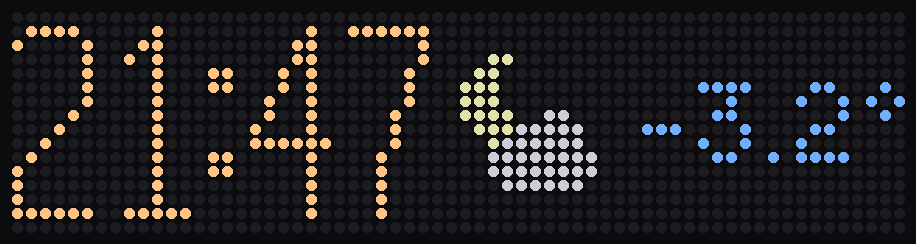

# BK-Light ESP32 clock

An ESP32 firmware that turns a cheap **BK-Light Bluetooth LED panel** (64×16 ACT1025/ACT1033 or 32×32 ACT1026) into a standalone wall clock: time, weather, calendar and messages, with auto-brightness from a light sensor. No phone app, no cloud account and no hub. The ESP32 talks to the panel over BLE and pulls everything else from the internet itself.




- **Clock:** NTP, any POSIX time zone, summer time handled automatically. Four fonts (Segment, Rounded, Slim, Dots), switchable on the settings page.
- **Weather:** [Open-Meteo](https://open-meteo.com/) (no API key). Icon plus temperature, one decimal between −10 and 10 °C, blue at 0 °C or below and orange from 25 °C.
- **Calendar:** reads a public/secret `.ics` link (iCloud, Google, Nextcloud…) itself, including repeating events. Today's and tomorrow's events rotate in for a few seconds a minute.
- **Messages:** `POST /msg` from Home Assistant, a script or a phone shortcut. Long messages rotate with the clock instead of hiding it.
- **Auto-brightness:** a phototransistor (two ranges on the ADC) or a VEML7700. Fast to brighten, slow to dim, and a red clock-only night mode in the dark.
- **Settings page** at `http://clock.local/`: font, brightness, night mode, live status.
- **Wi-Fi updates** from the Arduino IDE or a browser, with automatic rollback if a new build can't get online.

The panel protocol comes from [Bk-Light-AppBypass](https://github.com/Pupariaa/Bk-Light-AppBypass) by Puparia. See [Credits](#credits).

All screens at a glance: [64×16](docs/sheet_64x16.png), [32×32](docs/sheet_32x32.png). They are rendered by the firmware's own code on a PC (see [Previews](#previews-and-tests-on-a-pc)).

## Status

| Part | Status |
|---|---|
| Classic ESP32 (ESP32 Dev Module) + 64×16 ACT1025 panel, arduino-esp32 3.3.0 | ✅ ran for about a week in a living room |
| Wi-Fi updates from the Arduino IDE, rollback confirmation | ✅ tested, including two updates in a row |
| iCloud public calendar link | ✅ tested (yearly all-day events) |
| Phototransistor auto-brightness, pixel dimming | ✅ in use, lux calibration is approximate |
| Builds for ESP32-S3, 32×32 panel, VEML7700 | ⚠️ compile-tested only |
| Browser upload page `/update` | ⚠️ compile-tested only |
| Panel brightness command `05 00 04 80 LL` | ⚠️ from the iPixel protocol family, not confirmed on BK-Light. Pixel dimming is the default |
| arduino-esp32 2.0.x | ⚠️ compiles, not run on hardware |

## Hardware

- **ESP32** dev board. A classic ESP32 is what's tested; an ESP32-S3 should work (set the pins in the config). The firmware needs about 1.5 MB of flash per app slot and leaves ~60 KB of heap free.
- **BK-Light panel**, powered from its own USB supply. The ESP32 can share that 5 V supply.
- **Light sensor (optional):** a 3DU33 or similar NPN phototransistor plus 100 kΩ, 10 kΩ and 1 µF, or a VEML7700 breakout. Without a sensor, brightness and night mode come from the settings page and a schedule.

**Put the sensor** on the side of the panel, facing the room, and shield it from the panel's own light (a short black tube or heat-shrink). If it sees the panel, the display brightens itself and gets stuck at full brightness.

### Phototransistor wiring (`LIGHT_SENSOR 2`)

```
3V3 ─────────────── C  (3DU33)
                    E ──┬──────────────── GPIO34  (ADC1, input-only)
                        ├── 100 kΩ ────── GND     (dark range load)
                        ├── 1 µF ──────── GND     (kills 100 Hz LED-lamp flicker)
                        └── 10 kΩ ─────── GPIO27  (range switch)
```

- GPIO27 as an input (high impedance) is the dark range: only the 100 kΩ load, about 1–33 lx. GPIO27 driven LOW puts 10 kΩ in parallel for the bright range, about 22–370 lx. The firmware switches with hysteresis, so the ADC never reads in its dead zone below ~0.1 V.
- **Lead check:** open `/status.txt` and shine a phone torch on the sensor. The mV reading should jump. If it doesn't, the leads are swapped; reversing a phototransistor at 3.3 V doesn't damage it.
- **Calibration:** `PT_UA_PER_LUX` (default 0.75 µA/lx). Only the shape of the curve matters for dimming, so tune by feel: if the clock gets bright too early, raise it.
- On an ESP32-S3, use an ADC1 pin (GPIO1–10) for `PT_ADC_PIN`.

### VEML7700 (`LIGHT_SENSOR 1`)

VIN→3V3, GND→GND, SDA→`I2C_SDA`, SCL→`I2C_SCL` (21/22 on a classic ESP32, 8/9 on an S3 DevKitC).

## Build and flash

1. **Configure:** copy `src/clock_config.example.h` to `src/clock_config.h` and fill in Wi-Fi, `API_TOKEN` (a long random string), latitude/longitude and optionally `CAL_ICS_URL` and `LIGHT_SENSOR`. `clock_config.h` is git-ignored.
2. **Close the BK-Light app** on your phone. The panel accepts only one connection at a time.

**Arduino IDE 2.x**
- Board package: *esp32 by Espressif* (3.3.0 tested).
- Libraries (Library Manager): **NimBLE-Arduino** by h2zero 2.3.x, **ArduinoJson** by Benoit Blanchon 7.x.
- Open `bklight-esp32-clock.ino`. The folder must keep that name, so if you clone under a different name, rename the `.ino` to match.
- Tools → Board: **ESP32 Dev Module**. Tools → Partition Scheme: **Minimal SPIFFS (1.9MB APP with OTA/190KB SPIFFS)**.
- Upload over USB.

**PlatformIO**

```sh
pio run -e esp32-64x16 -t upload && pio device monitor
```

Environments: `esp32-64x16`, `esp32-32x32`, `s3-64x16`.

Then open `http://clock.local/` (or the IP printed on the serial monitor).

> **Slow compiles on Windows?** If the IDE sits at "Detecting libraries used…" for many minutes, Windows Defender is probably scanning every compiler run. Excluding `%LOCALAPPDATA%\Arduino15`, `%LOCALAPPDATA%\arduino` and your sketchbook folder usually fixes it.

## First power-on checklist

Watch the serial monitor (115200 baud):

1. **`[ble] connected in … ms (MTU 517)`.** If you see `no reply to hello`, check "last notify" on `/status.txt`. The panel probably answers differently.
2. **The clock appears.** If you get `no frame ACK`, try `BLE_CHUNK 244`.
3. **Brightness:** cover the sensor. The display should start dimming within a few seconds and settle in about 20 s. Brightening is faster than dimming.
4. **Power-cycle test (important):** unplug the panel, plug it back in, and let it boot **without** the ESP32.
   - If it shows the last clock screen, every frame is being saved to the panel's flash. A clock sends 1,500–6,000 frames a day, which could wear that flash. Set `FRAME_SLOT_BYTE 0x00` ("show, don't save" in pypixelcolor) and test again.
   - If it boots to its own default screen, frames aren't being saved.

## Settings page and API

`http://clock.local/` sets the font, brightness (auto or manual, with the auto range), night mode (off, schedule or light sensor) and red night clock. Changes apply immediately and are saved to flash a few seconds later. `/status.txt` shows everything: link quality and drops, sensor readings, weather, calendar fetches, firmware slot, heap.

Endpoints that put things on the screen need `API_TOKEN` (header `X-Token` or field `token`):

```bash
# a message for 5 minutes (form, JSON or a plain-text body all work)
curl -H "X-Token: TOKEN" -d "text=Pizza is here" -d "sec=300" http://clock.local/msg
curl -H "X-Token: TOKEN" -H "Content-Type: application/json" \
     -d '{"text":"Dinner!","sec":60,"color":"#ff8800"}' http://clock.local/msg
curl -H "X-Token: TOKEN" -d "text=" http://clock.local/msg          # clear
curl -H "X-Token: TOKEN" -d "level=30" http://clock.local/brightness  # manual
curl -H "X-Token: TOKEN" -d "level=auto" http://clock.local/brightness
```

A message up to 60 s long takes over the screen. A longer one rotates in for 6 s out of every 20 s, so the clock stays readable (`MSG_TAKEOVER_S`, `MSG_ROTATE_SHOW_S`, `MSG_ROTATE_PERIOD_S`).

## Calendar

Set `CAL_ICS_URL` to a calendar's `.ics` or `webcal://` link. The clock fetches it every 15 minutes and just after midnight, early in a minute so it never delays the minute change.

- **iCloud:** calendar sharing settings → **Public Calendar** → copy the `webcal://…` link.
- **Google:** calendar settings → **Secret address in iCal format**.
- `CAL_ICS_URL2` merges a second calendar.

The link is a secret: anyone who has it can read the calendar.

**Understood:** timed, all-day and multi-day events; daily, weekly (including every 2nd week on chosen days), monthly (the 15th, the 3rd Wednesday, the last Friday) and yearly rules with COUNT/UNTIL; EXDATE; moved, edited or cancelled single occurrences.
**Not understood:** BYSETPOS, BYWEEKNO, and events in a time zone other than the clock's (they show, shifted by the difference).

What's shown: today's events until 15 minutes after they start, all-day events labelled `LBL_TODAY`, and from 18:00 tomorrow's events with `LBL_TOMORROW`. The default labels are Slovak ("Dnes", "Zajtra"); change them in the config. Without a link, `POST /calendar` accepts lines like `2026-11-13 18:30 Title` or `2026-11-13 * All-day title`.

## Brightness

1. The sensor is read every 500 ms (20 samples over 20 ms, two periods of 100 Hz lamp flicker).
2. The value is smoothed on a log scale: about 4.5 s to follow the light going up, about 24 s going down, so a passing shadow barely registers.
3. It maps linearly in log(lux) from `LUX_DIM` (level 0) to `LUX_BRIGHT` (level 100), then onto the auto range from the settings page.
4. Changes smaller than 4 levels are ignored, which caps Bluetooth traffic.
5. Pixel dimming scales colours to 22–100 % (`PIXEL_DIM_MIN`/`MAX`). Below ~22 % thin strokes start to vanish.
6. Night mode switches on below `NIGHT_ON_LUX` and off above `NIGHT_OFF_LUX` (or on a schedule).

## Wi-Fi updates

Needs the "Minimal SPIFFS … with OTA" partition scheme (two app slots), flashed once over USB. After that:

- **Arduino IDE:** pick the network port **"clock at 192.168.x.x"** and Upload. The password is `OTA_PASSWORD`, which defaults to `API_TOKEN`. The IDE keeps it until it restarts. On Windows, allow the IDE through the firewall on the first prompt.
- **Browser:** Sketch → Export Compiled Binary, then upload the `.ino.bin` from the `build` folder at `http://clock.local/update` (user `admin`). Or from a shell: `curl -u admin:TOKEN -F "fw=@bklight-esp32-clock.ino.bin" http://clock.local/update`.

The panel shows **FIRMWARE UPDATE**, then **RESTART**. A new image is only confirmed after 30 s on Wi-Fi. If it crashes before that, or can't connect within 5 minutes, the bootloader goes back to the previous firmware. `/status.txt` shows the firmware id (first 8 hex digits of the image hash), the running slot and whether the new image is confirmed.

## Link drops

If the panel briefly shows its own screen, the BLE link dropped and the ESP32 reconnected (usually within a second, using the saved address). `/status.txt` counts drops and names the cause:

| Cause | Meaning | Try |
|---|---|---|
| supervision timeout | radio busy with Wi-Fi, or weak signal | move the ESP32 closer, raise `BLE_SUPERVISION_MS` |
| panel closed the link | the panel ended it | toggle `BLE_SEND_VALIDATION` and compare |
| no frame ACK | 3 frames in a row unanswered | check "last notify" bytes |

## Known limitations

- **Memory is tight during HTTPS.** On arduino-esp32 3.3.0, free heap can dip to a few KB while the calendar downloads. The download reads into a static buffer to avoid allocation failures, but large calendars on top of that are untested.
- **The BLE protocol is reverse-engineered.** The meaning of the `05 00 00 01 00` packet the original toolkit sends is unknown; it's off by default.
- **No HTTPS certificate check** for Open-Meteo and the calendar (`setInsecure()`). The data is read-only, but a malicious network could feed fake weather or events.
- **The settings page is open on your LAN** (it only changes the look). Message and calendar endpoints need the token.

## Previews and tests on a PC

The rendering, PNG encoder, calendar parser and brightness logic are portable C++:

```bash
g++ -std=c++17 -O2 -Isrc tools/preview.cpp src/render.cpp src/text.cpp src/png.cpp src/calendar.cpp src/settings.cpp -o preview_tool
mkdir -p out && ./preview_tool out && python3 tools/validate_preview.py out previews   # needs Pillow
g++ -std=c++17 -Isrc tools/ics_test.cpp src/ics.cpp src/calendar.cpp src/text.cpp -o ics_test && ./ics_test
```

`validate_preview.py` decodes every PNG, compares it pixel by pixel with the framebuffer, checks each frame against a reference implementation of the BK-Light frame format, and draws the LED-style previews and sheets.

## How it works

```
loop ─ Wi-Fi / mDNS ─ web server (/  /api/*  /status.txt  /msg  /calendar  /brightness  /update)
     ├ light sensor → AutoBright (log smoothing, fast up / slow down, hysteresis)
     ├ Open-Meteo every 15 min, calendar .ics every 15 min (HTTPS)
     └ build screen → render RGB framebuffer → pixels changed?
          → PNG (own fixed-Huffman deflate, ~150–300 B) → BK-Light frame → BLE write → ACK 05 00 02 00 03
```

A frame is only sent when the pixels change, plus a refresh every 10 minutes.

| File | What it does |
|---|---|
| `src/main.cpp` | Wi-Fi, web endpoints, page rotation, sending to the panel |
| `src/panel_ble.*` | NimBLE client: scan, handshake, writes, ACKs, reconnects, drop statistics |
| `src/render.*`, `src/icons.h`, `src/text.*`, `src/font5x8.h` | Layouts, clock fonts, weather icons, UTF-8 text (Central European letters included) |
| `src/png.*` | PNG encoder and BK-Light frame wrapper |
| `src/ics.*`, `src/calendar*.*` | iCalendar parser, event store, link fetcher |
| `src/autobright.h`, `src/light_sensor.*` | Brightness logic, VEML7700 and phototransistor drivers |
| `src/settings.*`, `src/web_ui.h` | Saved settings and the settings page |
| `src/weather.*` | Open-Meteo client |
| `src/ota.*` | Wi-Fi updates with rollback |
| `tools/` | Font generator, preview/test tool, frame validator, ICS tests |

## Credits

- **Panel protocol:** [Bk-Light-AppBypass](https://github.com/Pupariaa/Bk-Light-AppBypass) by Puparia / <https://github.com/Pupariaa> (MIT). This firmware is a from-scratch C++ implementation of the protocol documented there.
- **Protocol family reference:** [pypixelcolor](https://github.com/lucagoc/pypixelcolor).
- **Weather data:** [Open-Meteo.com](https://open-meteo.com/) (CC BY 4.0).
- **Font:** X11 misc-fixed 5×8 (public domain), with a few glyphs redrawn for LED readability.

Not affiliated with BK-Light or any panel manufacturer. Use at your own risk.

## License

[MIT](LICENSE)
